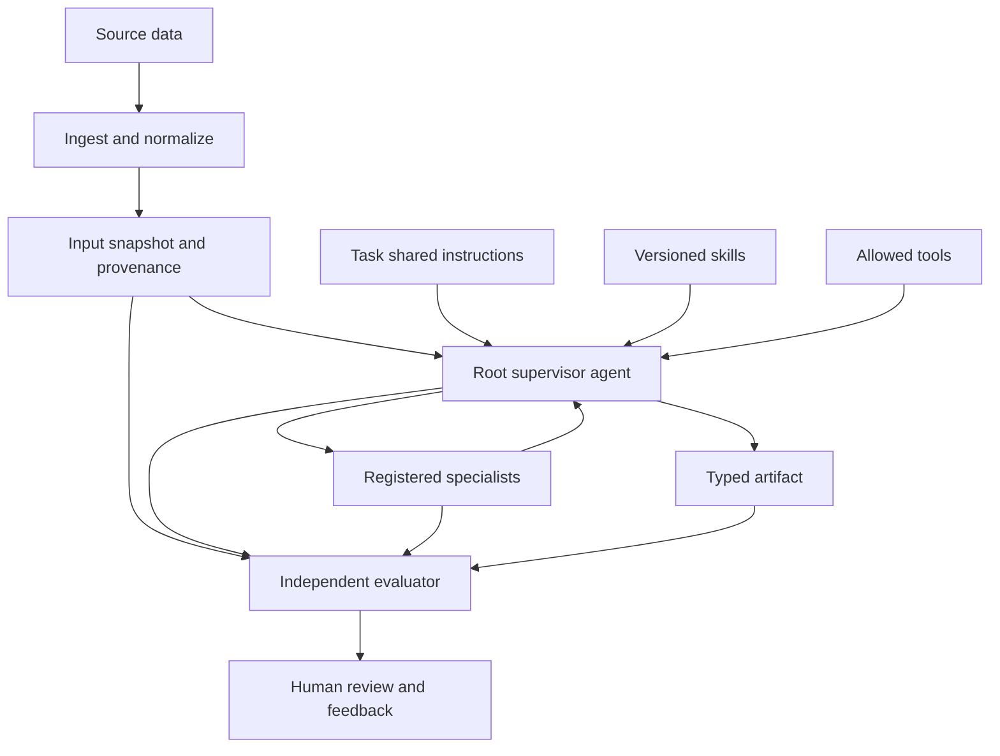

# Core architecture

## Goal

Loomer should support multiple analysis domains without making the data pipeline or evaluation system depend on one domain. A workflow is a reproducible run over source data, a selected agent composition, prompt revisions, and an output artifact schema.

## Building blocks

1. **Data flow** — accepts and normalizes source data, records stable source identifiers and metadata, and makes the same input available to agent runs. The data layer does not encode domain-specific judgments.
2. **Agent** — an independently developed unit with its own system prompt, implementation/version, input contract, and output contract. Agents can run alone or as a composition. A task can also provide shared instructions that apply across the composition.
3. **Artifact** — the durable result of a run. Every artifact uses the common envelope in `schemas/artifact-envelope.schema.json`; its `payload` follows a domain-specific schema such as the photo-curation schema.
4. **Evaluation** — a separate consumer of run and artifact records. It can inspect source references, agent composition, prompts, schema versions, and outputs, then calculate scenario-specific measures and collect human review. Evaluation must not be embedded in an agent's generation logic.
5. **Run record** — ties the input snapshot, workflow configuration, agent and prompt versions, artifact, and evaluation together for reproducibility and comparison.

## Data flow

The diagram describes logical responsibilities, not a commitment to a particular queue, database, orchestration engine, or model provider.

## Contracts and versioning

- Each input item has a stable ID and a source reference. Agents and artifacts refer to IDs rather than relying on array position or display name.
- The common envelope records `artifact_type`, schema version, run ID, creation time, provenance, and a domain payload.
- Workflow definitions identify the root agent, delegation policy, shared instructions, and artifact schema version. Agent definitions separately identify system prompt versions, skill references, allowed tools, and delegation permission.
- Schema changes that alter meaning require a new version. Old artifacts remain interpretable against the schema version they were produced with.
- Evaluators are versioned independently from agents. An evaluation result records evaluator version and metric definitions so results can be compared over time.

## Agent runtime, skills, and tools

An agent is a versioned implementation running inside a harness loop. The harness manages model turns, tool calls, intermediate results, and stopping conditions; an agent is not defined as a single LLM request. Each agent owns its system prompt and declares its available skills and allowed tools.

- **Skills** are versioned instruction and knowledge bundles. They are loaded into the agent context; they do not execute actions.
- **Tools** are callable capabilities with typed inputs/outputs and explicit permissions. They perform operations or retrieve information; their instructions do not replace the agent's system prompt.
- **Agent implementation** combines its system prompt, selected skills, allowed tools, model/runtime configuration, and loop policy.
- **Workflow shared instructions** provide task-specific guidance for one run. The artifact schema is also passed to the root agent and any specialists that need to produce or inspect the final payload.

### Supervisor-led collaboration

The default workflow should start a root or supervisor agent with the user's task, input snapshot, shared instructions, and output schema. The supervisor can decide which specialists to invoke and how to combine their results. It invokes them through a `delegate_agent` capability backed by the registered agent directory; the model does not create arbitrary agents or call hidden implementations directly.

Each specialist runs its own full harness loop with its own system prompt, skills, and tool allowlist. A specialist can return a structured result, evidence, and uncertainty. The supervisor may call multiple specialists, compare their results, request follow-up work, and synthesize the final artifact. The core records every handoff and intermediate result so the evaluation system can reconstruct what happened.

Delegation remains bounded by workflow policy: allowed versioned agent references, maximum handoff depth, maximum agent calls, maximum tool calls, and whether a specialist may delegate further. Start with specialists unable to delegate by default; allow nested delegation only when a workflow explicitly enables it. Token budgets and deadlines can be added when the harness reports the needed usage data.

Simple workflows can still use a deterministic DAG when their sequence is known in advance; supervisor delegation is the default for analysis tasks where the right specialist mix depends on the input.

## Evaluation and feedback

Evaluation runs outside the generation path and consumes immutable run evidence, including the selected root agent, agent and prompt versions, skill versions, tool calls, delegation tree, input snapshot, shared instructions, schema version, and final artifact. The initial loop is:

1. Run an evaluator against the saved artifact and its provenance.
2. Store metric results, evaluator version, and any evidence supporting each result.
3. Let a person accept, edit, or reject the artifact and add structured review notes.
4. Use reviewed examples to improve prompts, agent implementations, and metrics.

Automatically feeding evaluation feedback into agent code (an RSI loop) is a later capability. The first version should preserve human control and make every change attributable.

## Initial boundaries

- Keep source ingestion, domain agents, artifact validation, and evaluation as separable modules.
- Persist enough provenance to reproduce and audit an artifact; avoid putting provider-specific execution details into domain payloads.
- Treat prompts, agent code, schemas, workflow composition, and evaluator versions as distinct versioned inputs.
- Do not assume all outputs are text. The envelope can reference media and structured content through typed payload fields.

## Suggested implementation sequence

1. Build and stabilize generic source snapshot, workflow, agent, run, artifact, and evaluator contracts in `internal/core` — skeleton complete.
2. Add the supervisor runtime, separate skill/tool registries, bounded delegation, and execution trace — skeleton complete.
3. Adapt photo ingestion and curation as the first domain package — initial path complete.
4. Add specialist definitions, skill/tool loading, and richer multimodal photo inputs.
5. Add human review records, then select durable infrastructure based on real workload and usage.

## Current core implementation

`internal/core` contains generic source snapshot, workflow, agent, skill, tool, run, artifact, and evaluator contracts. The runner starts a registered root agent, loads its declared skills and tools from separate registries, permits policy-bounded delegation, records agent/tool/skill events, validates the root output, and persists the run and artifact. `internal/agent` provides a provider-neutral ReAct loop with an OpenAI-compatible chat-completions adapter. Its model calls route declared tools and specialist delegation through the core runtime. The photo CLI is the first model-backed integration; its current catalog contains metadata rather than image pixels, so the agent is explicitly instructed not to claim visual inspection.

The built-in validator supports the keywords used by the current contract schemas: types (including type unions), required properties, properties, additional properties, array items and bounds, uniqueness, string bounds and date-time format, numeric bounds, and enums. Unsupported schema keywords fail validation explicitly.
